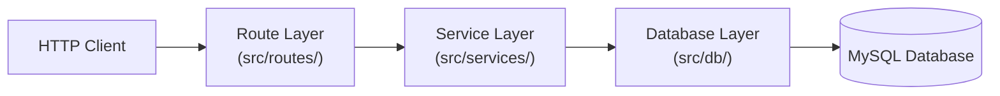
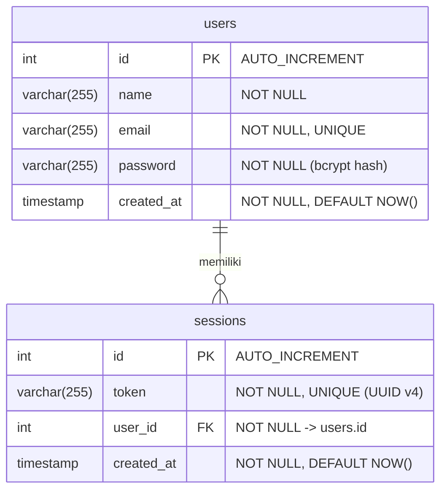

# Belajar Vibe Coding - Backend RESTful API

Aplikasi Backend RESTful API modern untuk manajemen pengguna (*user management*) dan autentikasi berbasis *session token*. Proyek ini dibangun menggunakan **Bun**, **ElysiaJS**, **Drizzle ORM**, dan **MySQL** dengan pendekatan arsitektur berlapis (*layered architecture*) yang bersih, *type-safe*, dan dilengkapi pengujian otomatis (*automated testing*).

---

## 📖 Tentang Aplikasi

Aplikasi ini menyediakan layanan dasar autentikasi dan otorisasi pengguna yang mencakup:
- **Registrasi Pengguna**: Pendaftaran akun pengguna baru dengan validasi input ketat dan pengamanan kata sandi menggunakan algoritma *hashing* `bcrypt` bawaan Bun (`Bun.password`).
- **Autentikasi Login**: Verifikasi kredensial email & kata sandi serta pembuatan *session token* unik berformat UUID v4 (`crypto.randomUUID()`).
- **Manajemen Sesi & Profil**: Pengambilan data profil pengguna yang sedang aktif berdasarkan *Bearer Token* yang tersimpan di database.
- **Logout**: Penghapusan sesi aktif dari database sehingga token tidak dapat digunakan kembali.
- **Monitoring Kesehatan Sistem**: Endpoint *health check* untuk memantau *uptime* server dan status koneksi ke database MySQL secara *real-time*.

---

## 🛠 Technology Stack & Library

### Core Stack
| Teknologi | Peran | Deskripsi |
| :--- | :--- | :--- |
| **[Bun](https://bun.sh/)** | Runtime, Package Manager, Test Runner | Runtime JavaScript/TypeScript berkinerja tinggi, sekaligus menyediakan utilitas native `Bun.password` (bcrypt), `crypto.randomUUID()`, dan `bun:test`. |
| **[TypeScript](https://www.typescriptlang.org/)** | Bahasa Pemrograman | Menjamin keamanan tipe data (*strict type-checking*) di seluruh lapisan kode. |
| **[ElysiaJS](https://elysiajs.com/)** | Web Framework | Framework HTTP ergonomis berbasis Bun dengan performa tinggi dan validasi skema bawaan (TypeBox). |
| **[Drizzle ORM](https://orm.drizzle.team/)** | Object-Relational Mapping (ORM) | ORM *type-safe* berbasis SQL untuk interaksi dan pemetaan skema database MySQL. |
| **[MySQL](https://www.mysql.com/)** | Database Relasional | Penyimpanan data persisten untuk entitas pengguna (`users`) dan sesi login (`sessions`). |

### Daftar Library (`package.json`)
#### Dependencies:
- `elysia` (`^1.2.10`): Framework utama pembuatan routing HTTP, middleware, error handling, dan validasi skema (`t` / TypeBox).
- `drizzle-orm` (`^0.38.4`): Query builder & ORM TypeScript untuk MySQL.
- `mysql2` (`^3.12.0`): Driver koneksi MySQL dengan dukungan *connection pooling* berbasis Promise (`mysql2/promise`).

#### DevDependencies:
- `drizzle-kit` (`^0.30.2`): CLI pendamping Drizzle untuk melakukan *push* skema, *generate* migrasi SQL, dan menjalankan *Drizzle Studio*.
- `@types/bun` (`latest`): Definisi tipe TypeScript untuk API bawaan Bun.
- `typescript` (`^5.0.0`): Compiler TypeScript untuk pengecekan tipe statis.

---

## 🏗 Arsitektur & Struktur Proyek

### Pola Arsitektur (*Layered Architecture*)
Aplikasi ini memisahkan tanggung jawab (*Separation of Concerns*) ke dalam 3 lapisan utama:
1. **Route / HTTP Layer (`src/routes/`)**: Menangani request HTTP, ekstraksi header (`Authorization: Bearer <token>`), validasi payload request menggunakan TypeBox (`t.Object`), serta mengatur kode status dan format response JSON.
2. **Service / Business Logic Layer (`src/services/`)**: Berisi logika bisnis murni seperti pengecekan duplikasi email, *hashing* dan verifikasi password, pembuatan token UUID, serta aturan otorisasi sesi.
3. **Database / Data Access Layer (`src/db/`)**: Mengelola *connection pool* MySQL dan definisi skema tabel menggunakan Drizzle ORM.



### Struktur Direktori & File
```text
belajar-vibe-coding/
├── drizzle/                 # Output file migrasi SQL dari Drizzle Kit (jika di-generate)
├── src/                     # Kode sumber utama aplikasi
│   ├── db/
│   │   ├── index.ts         # Inisialisasi pool koneksi mysql2 & instance Drizzle ORM
│   │   └── schema.ts        # Definisi skema tabel MySQL (users & sessions) beserta tipe TS
│   ├── routes/
│   │   └── users-route.ts   # Definisi endpoint /api/users/*, validasi input, & error handler
│   ├── services/
│   │   └── users-service.ts # Business logic (register, login, getCurrentUser, logout)
│   └── index.ts             # Entry point aplikasi, inisialisasi server Elysia, GET / & /health
├── tests/                   # Suite pengujian otomatis (Unit & Integration Tests)
│   ├── health.test.ts       # Pengujian endpoint GET / dan GET /health
│   └── users.test.ts        # Pengujian komprehensif seluruh skenario endpoint /api/users/*
├── .env.example             # Template konfigurasi environment variables
├── .gitignore               # Daftar file/folder yang diabaikan oleh Git
├── drizzle.config.ts        # Konfigurasi koneksi & direktori skema untuk Drizzle Kit
├── issue.md                 # Dokumen perencanaan tugas / issue tracker
├── package.json             # Daftar dependensi dan script perintah proyek
├── tsconfig.json            # Konfigurasi compiler TypeScript (mode strict)
└── README.md                # Dokumentasi proyek
```

### Konvensi Penamaan File & Kode
- **Nama File**: Menggunakan format `kebab-case` dengan akhiran sesuai perannya:
  - Routing: `<domain>-route.ts` (contoh: `users-route.ts`)
  - Business Logic / Service: `<domain>-service.ts` (contoh: `users-service.ts`)
  - Pengujian: `<domain>.test.ts` di dalam direktori `tests/` (contoh: `users.test.ts`, `health.test.ts`)
- **Variabel & Fungsi**: Menggunakan `camelCase` (contoh: `registerUser`, `extractBearerToken`).
- **Tipe & Interface**: Menggunakan `PascalCase` (contoh: `RegisterUserInput`, `LoginUserInput`, `User`, `Session`).
- **Kolom Database**: Menggunakan `snake_case` di level database MySQL (`user_id`, `created_at`) yang dipetakan ke properti `camelCase` di TypeScript (`userId`, `createdAt`).

---

## 🗄 Schema Database

Skema database didefinisikan di `src/db/schema.ts` dan terdiri dari dua tabel yang saling berelasi (**One-to-Many**: satu pengguna dapat memiliki banyak sesi aktif).



### 1. Tabel `users`
Menyimpan data akun pengguna terdaftar.
| Kolom Database | Properti TS | Tipe Data | Constraint | Keterangan |
| :--- | :--- | :--- | :--- | :--- |
| `id` | `id` | `INT` | `PRIMARY KEY`, `AUTO_INCREMENT` | ID unik pengguna |
| `name` | `name` | `VARCHAR(255)` | `NOT NULL` | Nama lengkap pengguna |
| `email` | `email` | `VARCHAR(255)` | `NOT NULL`, `UNIQUE` | Alamat email unik pengguna |
| `password` | `password` | `VARCHAR(255)` | `NOT NULL` | Hash password menggunakan `bcrypt` (cost: 10) |
| `created_at` | `createdAt` | `TIMESTAMP` | `NOT NULL`, `DEFAULT NOW()` | Waktu pembuatan akun |

### 2. Tabel `sessions`
Menyimpan token sesi autentikasi dari pengguna yang berhasil login.
| Kolom Database | Properti TS | Tipe Data | Constraint | Keterangan |
| :--- | :--- | :--- | :--- | :--- |
| `id` | `id` | `INT` | `PRIMARY KEY`, `AUTO_INCREMENT` | ID unik sesi |
| `token` | `token` | `VARCHAR(255)` | `NOT NULL`, `UNIQUE` | Token sesi berformat UUID v4 |
| `user_id` | `userId` | `INT` | `NOT NULL`, `FOREIGN KEY (users.id)` | Referensi ID pemilik sesi |
| `created_at` | `createdAt` | `TIMESTAMP` | `NOT NULL`, `DEFAULT NOW()` | Waktu pembuatan sesi login |

---

## 📡 Spesifikasi API

### Ringkasan Endpoint
| Method | Endpoint | Auth | Deskripsi |
| :--- | :--- | :---: | :--- |
| `GET` | `/` | Tidak | Informasi dasar aplikasi dan pesan sambutan |
| `GET` | `/health` | Tidak | Pemeriksaan kesehatan server & status koneksi database MySQL |
| `POST` | `/api/users` | Tidak | Registrasi pengguna baru |
| `POST` | `/api/users/login` | Tidak | Login pengguna & pembuatan *session token* |
| `GET` | `/api/users/current` | **Bearer Token** | Mengambil profil pengguna yang sedang login |
| `DELETE` | `/api/users/logout` | **Bearer Token** | Logout pengguna & menghapus *session token* |

---

### 1. Root Endpoint (`GET /`)
Mengembalikan informasi dasar layanan API.

- **Response Sukses (`200 OK`)**:
```json
{
  "name": "Belajar Vibe Coding API",
  "version": "1.0.0",
  "message": "Server is up and running with ElysiaJS, Bun, Drizzle ORM, and MySQL!"
}
```

---

### 2. Health Check (`GET /health`)
Mengecek *uptime* server dan mengeksekusi query `SELECT 1` ke MySQL untuk memastikan database terhubung.

- **Response Sukses (`200 OK`)**:
```json
{
  "status": "ok",
  "uptime": 42.158,
  "database": "connected",
  "timestamp": "2026-10-21T04:00:00.000Z"
}
```
- **Response Gagal (`503 Service Unavailable`)**:
```json
{
  "status": "error",
  "uptime": 42.158,
  "database": "disconnected",
  "error": "Database connection failed",
  "timestamp": "2026-10-21T04:00:00.000Z"
}
```

---

### 3. Registrasi Pengguna (`POST /api/users`)
Mendaftarkan pengguna baru ke sistem.

- **Aturan Validasi Request Body**:
  - `name`: String wajib diisi, panjang `1` s/d `255` karakter.
  - `email`: String wajib diisi, panjang `1` s/d `255` karakter, belum pernah terdaftar.
  - `password`: String wajib diisi, panjang `1` s/d `255` karakter.

- **Request Body**:
```json
{
  "name": "Eko Kurniawan",
  "email": "eko@localhost",
  "password": "rahasia123"
}
```
- **Response Sukses (`200 OK`)**:
```json
{
  "data": "OK"
}
```
- **Response Error (`400 Bad Request`)**:
```json
{
  "error": "Email sudah terdaftar"
}
```
*(Atau pesan error validasi seperti `"Nama harus diisi dan maksimal 255 karakter"`)*

---

### 4. Login Pengguna (`POST /api/users/login`)
Memvalidasi email dan password, lalu menyimpan serta mengembalikan token sesi UUID baru.

- **Aturan Validasi Request Body**:
  - `email`: String wajib diisi, panjang `1` s/d `255` karakter.
  - `password`: String wajib diisi, panjang `1` s/d `255` karakter.

- **Request Body**:
```json
{
  "email": "eko@localhost",
  "password": "rahasia123"
}
```
- **Response Sukses (`200 OK`)**:
```json
{
  "data": "550e8400-e29b-41d4-a716-446655440000"
}
```
- **Response Error (`400 Bad Request`)**:
```json
{
  "error": "Email atau password salah"
}
```

---

### 5. Get Current User (`GET /api/users/current`)
Mengambil data profil pengguna berdasarkan token sesi yang dikirimkan melalui header `Authorization`. Field `password` tidak disertakan dalam response.

- **Request Headers**:
  - `Authorization`: `Bearer <token>`

- **Response Sukses (`200 OK`)**:
```json
{
  "data": {
    "id": 1,
    "name": "Eko Kurniawan",
    "email": "eko@localhost",
    "created_at": "2026-10-21T04:00:00.000Z"
  }
}
```
- **Response Error (`401 Unauthorized`)** *(Jika header tidak ada, format bukan `Bearer <token>`, atau token tidak ditemukan)*:
```json
{
  "error": "Unauthorized"
}
```

---

### 6. Logout Pengguna (`DELETE /api/users/logout`)
Menghapus sesi token dari tabel `sessions` sehingga token tersebut tidak berlaku lagi.

- **Request Headers**:
  - `Authorization`: `Bearer <token>`

- **Response Sukses (`200 OK`)**:
```json
{
  "data": "OK"
}
```
- **Response Error (`401 Unauthorized`)**:
```json
{
  "error": "Unauthorized"
}
```

---

## ⚙️ Cara Setup Project

### 1. Prasyarat (*Prerequisites*)
Pastikan perangkat Anda telah terinstal:
- **[Bun](https://bun.sh/)** (versi `1.0` ke atas)
- **MySQL Server** (versi `8.0` ke atas direkomendasikan) yang sedang berjalan aktif

### 2. Clone Repository & Install Dependencies
```bash
git clone https://github.com/DejanJaya/belajar-vibe-coding.git
cd belajar-vibe-coding
bun install
```

### 3. Konfigurasi Environment Variables
Salin file `.env.example` menjadi `.env`:
```bash
cp .env.example .env
```
Sesuaikan isi file `.env` dengan konfigurasi MySQL lokal Anda:
```env
PORT=3000
DB_HOST=localhost
DB_PORT=3306
DB_USER=root
DB_PASSWORD=
DB_NAME=belajar_vibe_coding
```

### 4. Buat Database MySQL
Pastikan database sesuai `DB_NAME` sudah tersedia di MySQL Anda:
```sql
CREATE DATABASE IF NOT EXISTS belajar_vibe_coding;
```

### 5. Sinkronisasi Schema Database
Gunakan Drizzle Kit untuk mendorong (*push*) definisi skema di `src/db/schema.ts` langsung ke database MySQL:
```bash
bun run db:push
```
*(Opsional)* Jika Anda ingin membuat file migrasi SQL terlebih dahulu dan menjalankannya:
```bash
bun run db:generate
bun run db:migrate
```

---

## ▶️ Cara Menjalankan Aplikasi

### Mode Development (Hot-Reload)
Menjalankan server dengan fitur *watch mode* (otomatis *restart* saat ada perubahan kode):
```bash
bun run dev
```

### Mode Production
Menjalankan server secara langsung tanpa *file watcher*:
```bash
bun run start
```
Server akan berjalan di `http://localhost:3000` (atau sesuai `PORT` pada `.env`).

### Menjalankan Drizzle Studio (Database GUI)
Untuk melihat dan mengelola isi tabel `users` dan `sessions` melalui antarmuka web:
```bash
bun run db:studio
```

### Pengecekan Tipe TypeScript (*Typecheck*)
Untuk memastikan tidak ada error tipe data di seluruh kode dan unit test:
```bash
bun x tsc --noEmit
```

---

## 🧪 Cara Test Aplikasi

Aplikasi ini menggunakan test runner bawaan Bun (`bun:test`) dengan pendekatan pengujian integrasi langsung pada *instance* Elysia (`app.handle(new Request(...))`) dan database MySQL.

### Menjalankan Seluruh Test
```bash
bun test
```

### Menjalankan File Test Tertentu
```bash
# Hanya test health check & root endpoint
bun test tests/health.test.ts

# Hanya test fitur pengguna & autentikasi
bun test tests/users.test.ts
```

### Karakteristik & Cakupan Pengujian
1. **Isolasi Data Otomatis (`beforeEach`)**:
   Setiap skenario pengujian (`it(...)`) didahului oleh pembersihan tabel `sessions` terlebih dahulu, kemudian tabel `users`. Hal ini menjaga konsistensi data, mematuhi *foreign key constraint*, dan memastikan tidak ada ketergantungan status (*state pollution*) antar skenario test.
2. **Cakupan Skenario (`26 Test Scenarios`)**:
   - `tests/health.test.ts` (2 skenario): Pengujian response metadata `GET /` dan pengecekan koneksi database `GET /health`.
   - `tests/users.test.ts` (24 skenario):
     - **Registrasi (`POST /api/users`)**: Sukses registrasi & verifikasi hash `bcrypt`, duplikasi email, field kosong (`name`, `email`, `password`), panjang karakter melebihi 255 karakter (300 karakter), dan field wajib tidak dikirim.
     - **Login (`POST /api/users/login`)**: Sukses login & verifikasi penyimpanan UUID di tabel `sessions`, email tidak terdaftar, password salah, field kosong, input melebihi 255 karakter, dan field kurang.
     - **Current User (`GET /api/users/current`)**: Sukses mengambil profil tanpa field `password`, tanpa header `Authorization`, format header tanpa `Bearer `, token kosong, dan token tidak valid/tidak terdaftar.
     - **Logout (`DELETE /api/users/logout`)**: Sukses logout & verifikasi penghapusan sesi di database, penolakan akses ulang pada token yang sudah logout, header tidak valid/kosong, dan token tidak terdaftar.
